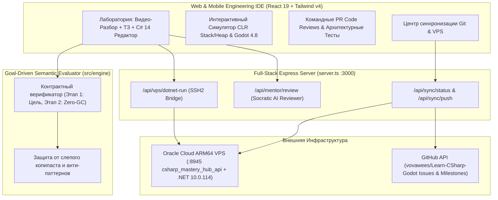

# C# 14 (.NET 10) & Godot 4.7 / 4.8 Engineering Lab

[](https://dotnet.microsoft.com/)
[](https://learn.microsoft.com/en-us/dotnet/csharp/)
[](https://godotengine.org/)
[](https://github.com/vovawees/Learn-CSharp-Godot)

Инженерная образовательная платформа и кроссплатформенная среда разработки (ПК + Телефон) для глубокого освоения **C# 14 (.NET 10)** и архитектуры игр на **Godot 4.7 Stable / 4.8 Beta 2**.

В отличие от поверхностных тренажёров с механическим копированием кода и заучиванием синтаксиса, платформа построена вокруг **инженерной цели (ТЗ)**, **работы с памятью CLR (Stack vs Heap)**, **семантической проверки контрактов** и **реальной компиляции .NET 10 на выделенном VPS**.

---

## Оглавление

- [Ключевая философия обучения](#ключевая-философия-обучения)
- [Архитектура системы (Mermaid)](#архитектура-системы-mermaid)
- [Учебная программа и модули](#учебная-программа-и-модули)
- [Дерево директорий](#дерево-директорий)
- [Быстрый старт и запуск](#быстрый-старт-и-запуск)

---

## Ключевая философия обучения

1. **Сначала — Выполнение Цели (Goal-First), Затем — Оптимизация (Zero-GC)**:
   - Любая твоя реализация C# (через `for`, `foreach`, тернарный оператор, `switch`, `Math.Clamp`, `record struct` или собственные вспомогательные методы) принимается, если она выполняет **функциональный контракт ТЗ**.
   - Вторым этапом анализатор проверяет **инженерную оптимизацию**: отсутствие лишних аллокаций в управляемой куче Gen 0, сложность алгоритма $O(1)/O(N)$ и корректную работу с деревом сцены Godot.
2. **Защита от бездумного копипаста и Сократовская защита кода**:
   - Каждый модуль начинается с интерактивного пошагового видео-разбора памяти CLR и узлов Godot, после чего открывается ТЗ и проверочный вопрос «Почему это работает именно так под капотом?».
3. **Удобная работа с телефона и ПК + Синхронизация через VPS**:
   - Мобильная панель быстрых токенов C# 14 (`readonly struct`, `ReadOnlySpan<int>`, `partial`, `MoveAndSlide()`, `EmitSignal`), мгновенная синхронизация состояния через сервис `csharp_mastery_hub_api` на Oracle Linux 9.8 ARM64 и удалённая компиляция в настоящем `.NET SDK 10.0.114`.

---

## Архитектура системы (Mermaid)



---

## Учебная программа и модули

| Модуль | Тема и стек | Инженерная цель (ТЗ) | Фокус оптимизации |
| :--- | :--- | :--- | :--- |
| **01** | **C# 14 / .NET 10: Stack, Heap & Value Types** | Расчёт затухания физического импульса с отсечением микро-дрейфа `<= 0.01f` | `readonly struct`, `0 B` в Gen 0 Heap, отсутствие упаковки (boxing) |
| **02** | **C# 14: `ReadOnlySpan<T>` & `params ReadOnlySpan<T>`** | Однопроходная фильтрация и ограничение пиков буфера урона | Сложность $O(N)$, отказ от `.ToArray()` / `.ToList()` в горячем цикле |
| **03** | **Godot 4.7 Stable: `_PhysicsProcess` & `MoveAndSlide`** | Детерминированный контроллер `CharacterBody2D` с учётом `(float)delta` | `partial class` для Source Generator, запрет `GetNode` внутри физического тика |
| **04** | **Godot 4.8 Beta 2: `[Signal]` EventHandler & Decoupling** | Изолированный `HealthComponent` со строгими инвариантами `[0, MaxHp]` | Слабая связность (Observer), защита от спама сигналов после смерти |

---

## Дерево директорий

```text
.
├── .ai/                              # Техническая база знаний для ИИ-сессий
│   ├── architecture.txt              # Архитектура модулей и контрактов
│   ├── roadmap_status.txt            # Статус разработки и план следующих шагов
│   └── vps_deployment.txt            # Карта деплоя и портов на Oracle Cloud VPS
├── src/
│   ├── assets/images/                # Сгенерированные инженерные схемы CLR и Godot
│   ├── components/
│   │   ├── TopBar.tsx                # Навигационная панель (3-зонный контракт)
│   │   ├── EngineeringWorkspace.tsx  # Видео-разбор, ТЗ, C# 14 редактор и проверка контрактов
│   │   ├── ClrGodotSimulator.tsx     # Интерактивный симулятор памяти .NET 10 и кадра Godot 4.8
│   │   ├── EngineeringAssessments.tsx# Практические PR Code Reviews
│   │   └── GitVpsSyncHub.tsx         # Синхронизация с VPS (.NET 10) и GitHub Issues
│   ├── data/
│   │   └── curriculum.ts             # Учебные модули, слайды, ТЗ и PR-задачи
│   ├── engine/
│   │   ├── csharpEvaluator.ts        # Семантический верификатор целей и аллокаций
│   │   └── csharpEvaluator.test.ts   # Модульные тесты (node:test)
│   ├── App.tsx                       # Корневой компонент и синхронизация состояния
│   ├── index.css                     # Конфигурация Tailwind CSS v4 и шрифтов
│   └── main.tsx                      # Точка входа React 19
├── server.ts                         # Express + Vite сервер, SSH-мост к VPS и GitHub API
├── package.json                      # Зависимости и скрипты запуска
└── tsconfig.json                     # Конфигурация TypeScript
```

---

## Быстрый старт и запуск

```bash
# 1. Установка зависимостей
npm install

# 2. Запуск модульных тестов верификатора контрактов
npx --yes tsx --test src/engine/csharpEvaluator.test.ts

# 3. Запуск full-stack сервера разработки (порт 3000)
npm run dev

# 4. Сборка production-бандла
npm run build
```
