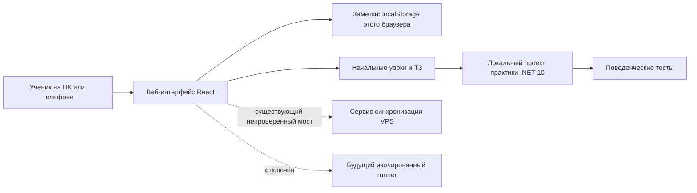

# C# & Godot Engineering Lab

[](https://dotnet.microsoft.com/download/dotnet/10.0)
[](https://godotengine.org/)
[](https://github.com/vovawees/Learn-CSharp-Godot/issues)

Открытая лаборатория для глубокого освоения C#: сначала основы и самостоятельное решение задач, затем архитектура и игровая разработка в Godot 4.7 .NET. Проект находится в разработке; возможности ниже разделены на готовые и планируемые.

## Содержание

- [Как здесь учиться](#как-здесь-учиться)
- [Что работает и что ещё предстоит](#что-работает-и-что-ещё-предстоит)
- [Быстрый старт](#быстрый-старт)
- [Первая практика с реальными тестами](#первая-практика-с-реальными-тестами)
- [Архитектура](#архитектура)
- [Структура проекта](#структура-проекта)
- [Материалы и план](#материалы-и-план)

## Как здесь учиться

**Объяснение → прогноз → своя реализация → проверка → объяснение → изменение требований.** Правильное поведение важнее совпадения кода с примером. Оптимизацию имеет смысл рассматривать после достижения цели и подтверждать измерениями. Тесты показывают ошибки на проверенных входах, но не доказывают понимания.

## Что работает и что ещё предстоит

| Возможность | Состояние |
| --- | --- |
| Основы C#: 3 первых занятия, объяснения, ТЗ и ссылки на видео | В веб-интерфейсе и [учебных материалах](curriculum/foundation/README.md) |
| Заметки к занятиям | Сохраняются в localStorage текущего браузера; синхронизации между устройствами нет |
| Практика «здоровье после урона» | Отдельная локальная программа .NET 10 с реальными проверками поведения |
| Продвинутые материалы CLR/Godot и PR-вопросы | Черновой интерфейс; пояснения, предположения и численные показатели требуют проверки |
| Автоматический зачёт задач в интерфейсе | Отключён: старый анализатор сопоставлял текст и мог выдавать вымышленные результаты; [#6](https://github.com/vovawees/Learn-CSharp-Godot/issues/6) |
| Удалённый запуск C# на VPS | Отключён до изоляции и ограничения ресурсов; [#9](https://github.com/vovawees/Learn-CSharp-Godot/issues/9) |
| Синхронизация заметок и надёжного прогресса | Не готова; [#10](https://github.com/vovawees/Learn-CSharp-Godot/issues/10) |

Старые результаты заданий нельзя считать подтверждённым прохождением. VPS и существующий сервис в ходе последней доработки не проверялись и не перезапускались; состояние в `.ai/vps_deployment.txt` — историческое. Изменения репозитория не означают автоматического деплоя.

## Быстрый старт

Нужны Node.js 24, npm и .NET SDK 10. Для редактирования Godot-проектов позже потребуется [Godot 4.7 .NET](https://docs.godotengine.org/en/4.7/tutorials/scripting/c_sharp/index.html).

```bash
git clone https://github.com/vovawees/Learn-CSharp-Godot.git
cd Learn-CSharp-Godot
npm ci
npm run dev
```

Открой адрес, который выведет сервер (по умолчанию `http://localhost:3000`). Начальный раздел — «Основы C#». Приложение не требует VPS для чтения уроков. Существующие мосты синхронизации и AI требуют отдельной настройки; см. `.env.example`, но не считай их работоспособность проверенной без фактического теста.

```bash
npm run lint       # TypeScript
npm run build      # клиентский production-бандл
npm test           # тесты TypeScript; не проверяют корректность C# решений
```

Заметки остаются в браузере: очистка данных браузера их удалит. Для переноса между устройствами вручную сохрани записи в файл или Git до появления синхронизации.

## Первая практика с реальными тестами

1. Прочитай [урок и ТЗ](curriculum/foundation/health-lab/README.md).
2. Реализуй свой метод в `curriculum/foundation/health-lab/Health.cs`.
3. Из корня репозитория выполни:

```bash
dotnet run --project curriculum/foundation/health-lab/HealthLab.csproj
```

Проверяется 10 201 допустимая пара входных значений и 10 недопустимых случаев. Стартовый шаблон намеренно не проходит. При ошибке тесты покажут ожидаемое и фактическое поведение; ошибки компиляции показываются компилятором. Тесты выполняют твой код локально, не в изолированной песочнице. Они не передают результаты в веб-приложение и не измеряют знание или производительность.

## Архитектура



Симулятор и старый анализатор — демонстрационные компоненты, не профилировщик CLR, не Godot и не поведенческие тесты. В частности, `struct` не гарантирует, что значение всегда находится в стеке или что вся программа не выделяет память.

## Структура проекта

```text
.
├── .ai/                            # Техническая память и статус
├── curriculum/foundation/          # Начальные занятия и ссылки на материалы
│   └── health-lab/                 # Самостоятельная практика .NET 10
├── src/components/                 # React-интерфейс
├── src/data/                       # Существующие продвинутые материалы
├── src/engine/                     # Демонстрационный анализатор и тесты UI-ограничений
├── server.ts                       # Express/Vite; runner отключён
├── package.json / package-lock.json
└── .env.example                    # Шаблон настроек
```

## Материалы и план

- [Microsoft: C# for Beginners](https://learn.microsoft.com/en-us/shows/csharp-for-beginners/) — видео на английском.
- [Официальное руководство по C#](https://learn.microsoft.com/dotnet/csharp/) и [документация Godot C#](https://docs.godotengine.org/en/4.7/tutorials/scripting/c_sharp/index.html).
- [Учебный маршрут](curriculum/foundation/README.md) — от основ до игровых проектов; будущие этапы отмечены как план.
- [Issues](https://github.com/vovawees/Learn-CSharp-Godot/issues) и milestones — незавершённая работа и приоритеты.
